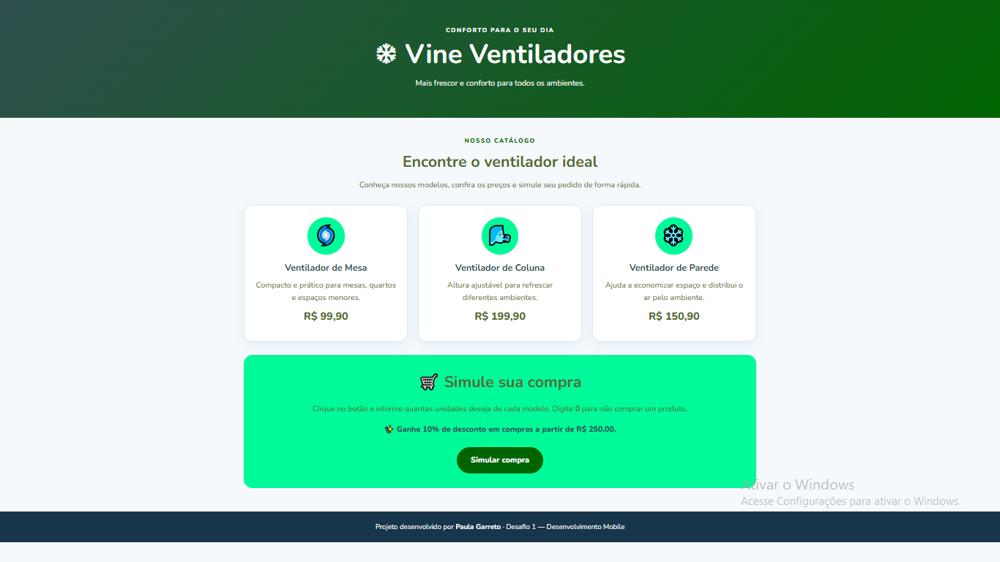

# Desafio 1 — Minha Loja: Simulador de Compras

**Aluno(a):** Paula Garreto 
**Trilha:** Desenvolvimento Mobile  
**Projeto:** Brisa Ventiladores

## Apresentação da loja

A Brisa Ventiladores é uma loja fictícia de ventiladores criada para o primeiro desafio da trilha. A página apresenta três modelos e permite simular uma compra usando perguntas do JavaScript.

## Produtos e preços

| Produto | Descrição | Preço |
|---|---|---:|
| Ventilador de Mesa | Compacto e prático para espaços menores | R$ 129,90 |
| Ventilador de Coluna | Modelo com altura ajustável | R$ 219,90 |
| Ventilador de Parede | Ajuda a economizar espaço | R$ 179,90 |

**Regra de desconto:** compras com subtotal igual ou superior a R$ 300,00 recebem 10% de desconto. Essa regra foi definida para este projeto.

## Tecnologias utilizadas

- HTML5: estrutura e conteúdo da página.
- CSS3: cores, layout responsivo e apresentação visual.
- JavaScript: entrada de quantidades, cálculos, desconto e resumo da compra.

## Como executar

1. Baixe ou clone este repositório.
2. Abra `index.html` em um navegador atualizado.
3. Clique em **Simular compra**.
4. Digite uma quantidade inteira igual ou maior que zero para cada produto. Digite `0` se não quiser comprar aquele item.
5. Confira o resumo apresentado no alerta final.

Não é necessário instalar bibliotecas adicionais.

## Captura de tela

Abra `index.html` no navegador, tire uma captura de tela mostrando o nome da loja, os produtos e o botão e salve a imagem como `captura.png` dentro da pasta `assets`.

Depois de adicionar a imagem ao repositório, ela aparecerá abaixo:

## Testes realizados

Marque os testes depois de executá-los no navegador:

- [ ] Digitar `0` para os três produtos informa que nenhum produto foi selecionado.
- [ ] Comprar 1 ventilador de mesa mostra total de R$ 129,90 e nenhum desconto.
- [ ] Comprar 2 ventiladores de mesa mostra subtotal de R$ 259,80 e nenhum desconto.
- [ ] Comprar 1 ventilador de mesa e 1 de coluna mostra subtotal de R$ 349,80, desconto de R$ 34,98 e total de R$ 314,82.
- [ ] Digitar uma quantidade negativa, decimal ou texto apresenta mensagem de quantidade inválida.

## Dificuldade encontrada e aprendizado

**Adapte este exemplo à sua experiência real depois de praticar:** uma dificuldade foi compreender como transformar a resposta de `prompt()` em número usando `Number()`. Aprendi como armazenar quantidades em variáveis, multiplicar o preço pela quantidade e usar uma condição `if` para verificar se o subtotal permite aplicar o desconto.

## Uso de inteligência artificial

Utilizei o ChatGPT como apoio para planejar a estrutura inicial, organizar o HTML, personalizar o CSS e compreender a lógica do JavaScript. Adaptei o projeto para uma loja fictícia de ventiladores. Verifiquei o resultado abrindo a página no navegador e executando os testes descritos neste README.

Mantenha essa declaração apenas se ela representar corretamente como você utilizou a ferramenta. Depois de executar os testes, atualize esta seção com o que realmente verificou, corrigiu e aprendeu.
